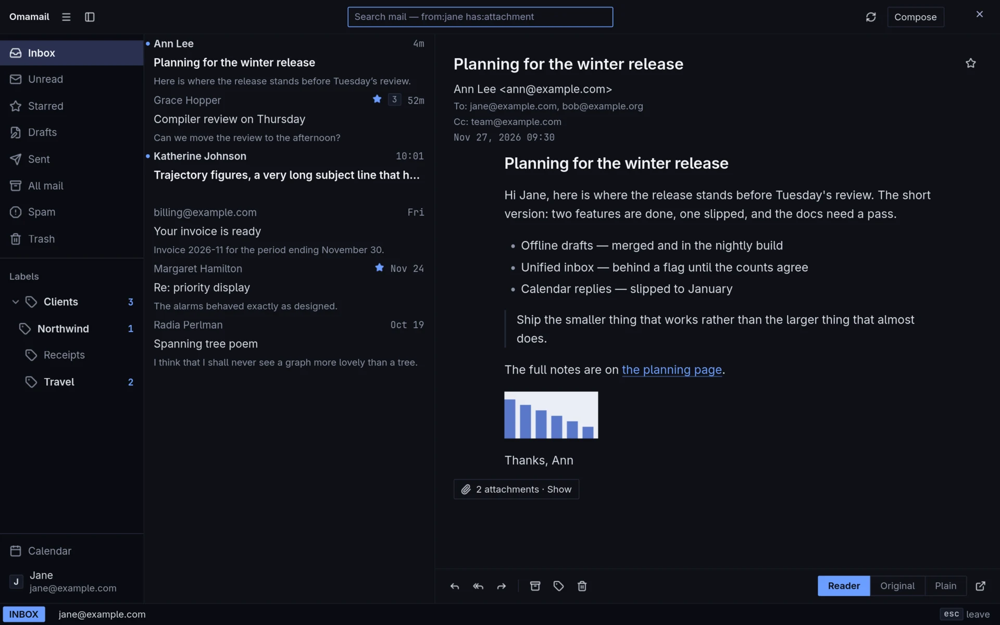
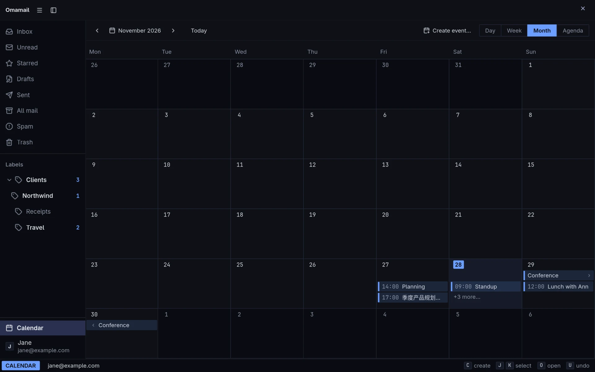
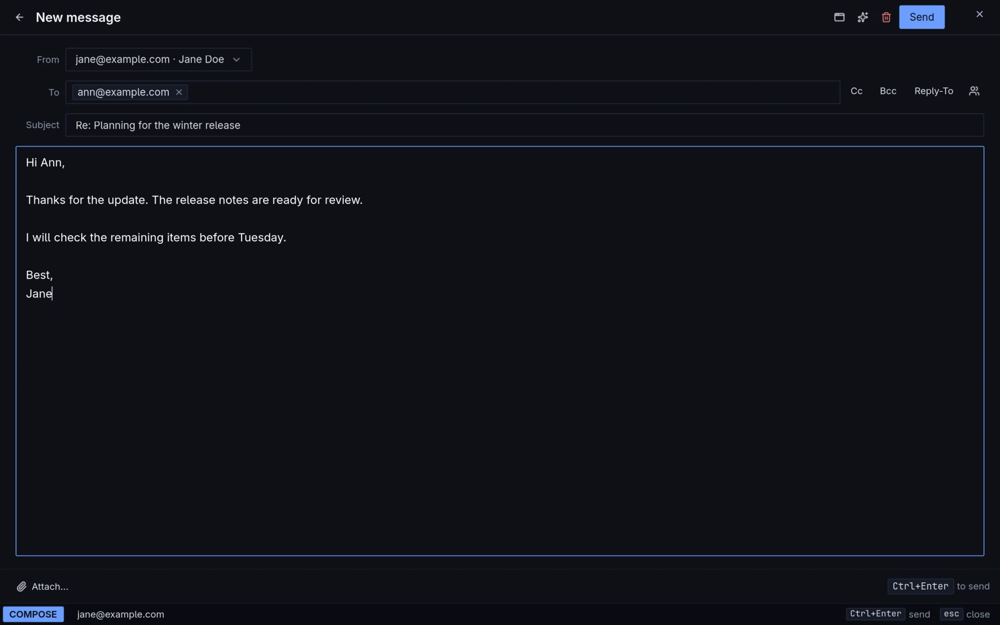
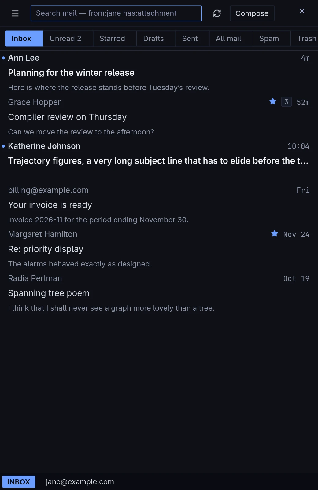

# Omamail

Omamail is a native email and calendar app with multiple accounts and keyboard navigation. It runs as an NSH app on desktop and mobile, or as an Omarchy shell plugin.



Screenshots show the native Linux app in its dark theme, using fictional demo mailboxes and messages.

**If this helps you, please [sponsor me](https://github.com/sponsors/huacnlee).**

## Install

macOS (Apple silicon) and Linux (x86_64):

```sh
curl -fsSL https://huacnlee.github.io/omamail/install.sh | sh
```

Windows (x86_64), in PowerShell:

```powershell
irm https://huacnlee.github.io/omamail/install.ps1 | iex
```

The installer picks the latest release for your system and checks it against the release's `SHA256SUMS` before installing. It needs no administrator access, and it replaces Omamail 0.12 or earlier while keeping your accounts and settings. From then on Omamail updates itself. For a specific version, another location, removal or a manual install, see the [installation guide](docs/install.md).

### Omarchy bar entry (optional)

On [Omarchy](https://omarchy.org), the plugin puts an envelope in the bar that opens Omamail, or this page when the app is not installed yet:

```sh
omarchy plugin add https://github.com/huacnlee/omamail.git --enable
```

## Repository layout

| Path | What it is |
|---|---|
| `App.tsx`, `src/`, `nsh.json`, `theme.json` | The NSH app |
| `ext/omamail-native/` | The app's Rust module, linking the mail library |
| `core/` | The mail library and `omamail` CLI (Rust) |
| `omarchy/` | The Omarchy bar notice widget (`omarchy/notice/`) and the release tooling; no mail panel |

## Run from source

Install Rust and the [NSH CLI](https://nsh.dev), then run from the repository root:

```bash
nsh dev
```

Library tests run from `core/`: `cargo test --lib`.

## Features

- **Multiple mailboxes:** Gmail, Outlook, Microsoft 365, HEY, JMAP and IMAP/SMTP, including Fastmail, iCloud and self-hosted servers.
- **Mail and calendar:** read, search, compose, manage attachments and respond to meeting invitations. Available actions depend on your provider.
- **Keyboard navigation:** `j`/`k` to move, `r` to reply, `c` to compose, `/` to search and `?` for all shortcuts.
- **AI assistance in Omarchy:** ask about selected messages and review suggested drafts with Claude, OpenCode V2 or Codex. Follow your Omarchy default, or select an agent and optional model in Settings. An unsupported system default disables the AI action with a setup explanation. Conversations retain follow-ups and draft proposals; `/clear`, `/history` and `/diagnose` manage the chat.
- **Desktop integration:** native notifications and a compact layout for smaller windows; the Omarchy plugin also provides the bar widget and `mailto:` integration.
- **Privacy controls:** credentials stored in the system keyring and remote images blocked until you choose to load them.

  

## Add your mailbox

Choose a provider in Settings. Released builds of Gmail sign in with an included Google OAuth client, and you can use your own instead; Outlook and Microsoft 365 need a Microsoft app registration. HEY uses the official [HEY CLI](https://github.com/basecamp/hey-cli). JMAP and IMAP usually use an app password or API token.

See [mailbox setup](docs/MAILBOXES.md) for provider instructions and limitations, including Microsoft 365 and Proton Mail Bridge.

## Make Omamail the default mail client

Omarchy opens HEY's web app on `SUPER+SHIFT+E`. Choose **Settings → Default mail client → Set as default** to make Omamail open `mailto:` links, `SUPER+SHIFT+E`, and `SUPER+SHIFT+ALT+E` for a new message.

The key bindings go in a clearly marked block in `~/.config/hypr/bindings.lua`; Omarchy's own files are never changed. **Undo** removes the block and leaves the file as it was.

## Open the Omarchy plugin from the keyboard

To use another key, add this to `~/.config/hypr/bindings.lua`:

```lua
o.bind("SUPER + SHIFT + G", "Omamail", "omarchy shell shell toggle omamail '{}'")
```

Press `?` in Omamail for the shortcut sheet, or see the [keyboard guide](docs/KEYS.md).

## Text size

Omamail follows the Omarchy font settings, so the whole window (text, icons and spacing) scales with `base-size` in `~/.config/omarchy/shell.toml`:

```toml
[font]
base-size = 14
```

The change applies without a restart. To enlarge only the message body, use `Ctrl+=` / `Ctrl+-` / `Ctrl+0` in the reader; the zoom is remembered. Prefer these over `QT_SCALE_FACTOR`, which scales the window like an image, halves the usable space at `2` and blurs at fractional values.

## Help and contributing

- [Backend installation, updates, release flow, and recovery](docs/BACKEND-RUNTIME.md)
- [Contributing](CONTRIBUTING.md)

Omamail is an independent project and is not affiliated with Google, Microsoft or 37signals. Gmail, Outlook and HEY belong to their respective trademark owners.

Licensed under the [MIT License](LICENSE).

## More projects

- [Disktree](https://huacnlee.github.io/disktree/) — A native disk-space explorer for macOS and Linux. See what fills your disk as a nested treemap, and review every path before removing anything.
- [Omasend](https://huacnlee.github.io/omasend/) — A native LocalSend client. Share files, folders, screenshots, and text over your local network, with no account or cloud upload.
- [Noop](https://huacnlee.github.io/noop/) — Your own AI team. Claude Code and Codex agents on your own computers do the daily work and only ask when something really needs you.
- [huacnlee/cargo](https://huacnlee.github.io/cargo/) — A drop-in Cargo fork: every git worktree of a project shares one build directory, which stays under a size limit on its own.
- [omarchy-mihoro](https://github.com/huacnlee/omarchy-mihoro) — An Omarchy bar panel for Mihoro. Monitor your proxy, switch between Rule, Global, and Direct modes, and manage subscriptions.
- [omarchy-which-key](https://github.com/huacnlee/omarchy-which-key) — Which Key for the desktop. Hold Super to see a shortcut guide drawn from your active Omarchy and Hyprland keybindings.
